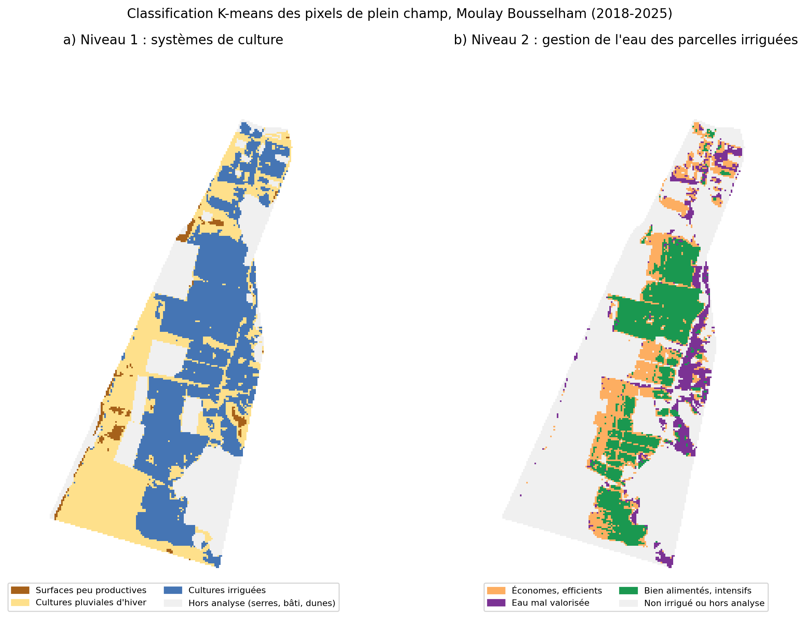
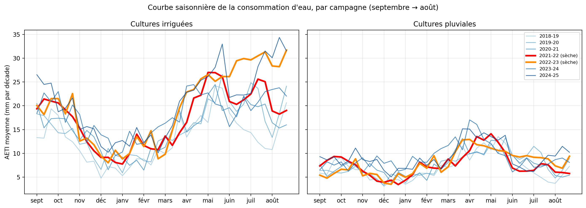
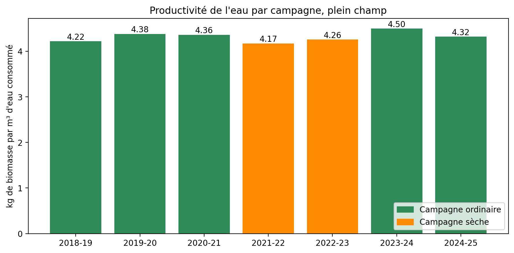

# Besoins en eau et efficacité de l'irrigation — Moulay Bousselham (Loukkos, Maroc)

Analyse par satellite de la consommation d'eau d'un périmètre irrigué côtier, à partir des données **FAO WaPOR v3** à 20 m (2018-2025).

**Problématique.** Les cultures reçoivent-elles assez d'eau, trop, ou pas assez ? Où, et à quel moment de la saison ?

## Conclusion en trois lignes

1. Le plein champ se partage entre un **cœur irrigué** (≈ 55 %) et des **cultures pluviales d'hiver** (≈ 43 %) ; les écarts de consommation se jouent **de mai à août**, uniquement sur les parcelles irriguées.
2. Pendant la sécheresse 2021-2023, l'**irrigation a compensé** la baisse de pluie (2021-22 : pluie ÷ 2, irrigation + 38 %), avec une **productivité de l'eau stable** (4,2 à 4,5 kg/m³), en léger recul les années sèches.
3. Parmi les irrigants, 45 % sont **bien alimentés**, 36 % **économes et efficients** et 19 % **valorisent mal l'eau**, surtout en bordure de lagune ; l'uniformité entre irrigants s'est améliorée (CV de 39 % à ≈ 20 %).

## Figures clés

| | |
|---|---|
|  | **Figure 1.** Classification K-means en deux niveaux : systèmes de culture, puis gestion de l'eau des parcelles irriguées. |
|  | **Figure 2.** Consommation d'eau par décade, de septembre à août, pour chaque campagne (campagnes sèches en trait épais). |
|  | **Figure 3.** Productivité de l'eau par campagne (kg de biomasse par m³ consommé). |

## Données

| Source | Variables | Résolution |
|---|---|---|
| FAO WaPOR v3 (package `wapordl`) | AETI (ETR), NPP (biomasse) | 20 m, décadaire |
| FAO WaPOR v3 | RET (ET0), pluie | grossière, décadaire |
| Esri / Impact Observatory, *10m Annual Land Use Land Cover* (Planetary Computer) | Occupation du sol | 10 m, annuelle (2018-2023) |
| Digitalisation manuelle (geojson.io) | 15 blocs de serres | — |

## Méthode

1. **Préparation** : conversion des moyennes journalières en totaux décadaires, ré-échantillonnage de la RET et de la pluie sur la grille de 20 m, masques « plein champ » (Esri « cultures », hors serres) et « serres ». La LCC de WaPOR n'existe plus en v3 (erreur 404).
2. **Analyse par campagne agricole** (septembre → août), 7 campagnes complètes de 2018-19 à 2024-25.
3. **Quatre indicateurs** :
   - ET relative (AETI ÷ RET), rapportée aux 5 % meilleurs pixels de la même décade, car le seuil de 0,7 n'est atteint par aucune parcelle en été ;
   - apport d'irrigation = AETI − 0,8 × pluie (pluie efficace), sans valeurs négatives ;
   - productivité de l'eau = biomasse sèche (NPP × 22,222) ÷ AETI ;
   - uniformité = coefficient de variation de l'AETI entre pixels.
4. **K-means en deux niveaux** sur des variables standardisées et non redondantes, nombre de groupes validé par la méthode du coude et le coefficient de silhouette (0,52 au niveau 1, 0,43 au niveau 2).

## Limites

- RET et pluie à résolution grossière ; RET probablement surestimée en bord de mer.
- AETI sous-estimée sous serre : serres exclues des indicateurs.
- Biomasse WaPOR totale (racines comprises) : valeurs absolues de productivité à interpréter avec prudence.
- Pas de carte Esri pour 2024-2025 (carte 2023 réutilisée).
- Zone délimitée visuellement, sans les limites officielles du périmètre.
- L'irrigation estimée est l'eau consommée par les cultures, pas l'eau prélevée.

## Reproduire l'analyse

1. Ouvrir `Irrigation_Gharb_WaPOR.ipynb` dans Google Colab.
2. Placer dans `Mon Drive/Projet_WaPOR/` les fichiers `zone_moulay_bousselham.geojson` et `serres_moulay_bousselham.geojson`.
3. `Exécution → Tout exécuter`. Le premier téléchargement prend environ 2 h ; les fichiers sont ensuite réutilisés.

## Sources

- FAO (2024). *WaPOR — Water Productivity through Open access of Remotely sensed derived data*, version 3. https://data.apps.fao.org/wapor
- Karra, K. et al. (2021). *Global land use/land cover with Sentinel-2 and deep learning*. Données Impact Observatory, Microsoft et Esri, licence CC BY 4.0. https://planetarycomputer.microsoft.com/dataset/io-lulc-annual-v02
